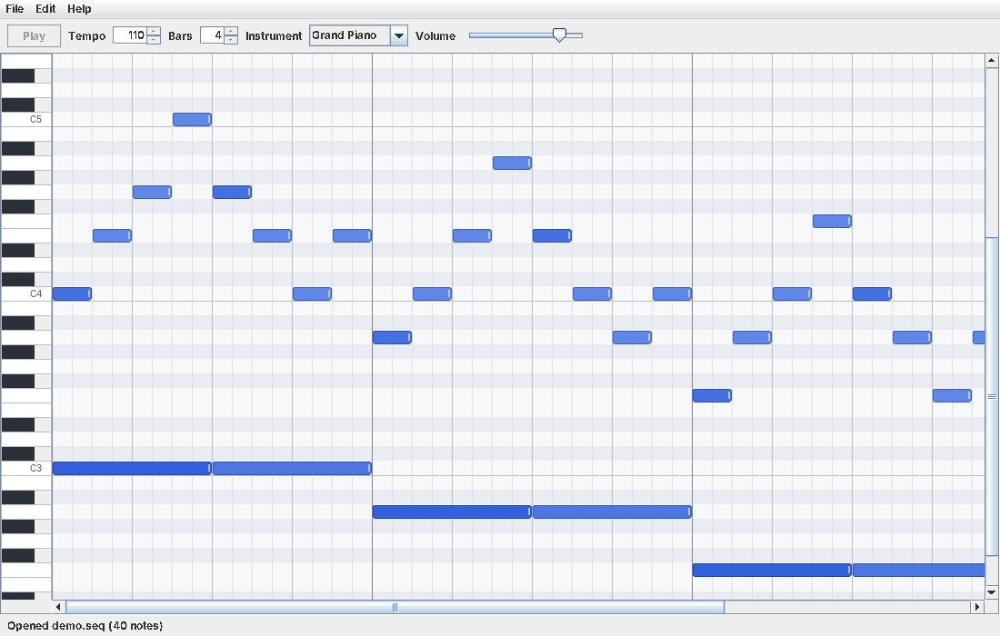

# Music Sequencer

A Java desktop music sequencer with a Swing GUI. Notes are placed on an interactive
grid (a piano roll) and played through the Java MIDI API, both as you edit and when
the whole song loops.



## Features

- **Note grid**: rows are pitches C2–C7, columns are sixteenth-note steps, with beat and bar lines.
- **Real-time sound**: every note you place, move, or change the volume of is played
  immediately through `javax.sound.midi`. During playback the sequence is rebuilt on
  each edit and keeps playing from the same position, so changes are heard right away.
- **Mouse controls**
  - click an empty cell to place a note, keep dragging to lengthen it
  - drag a note to move it (all selected notes move together); drag its right edge to resize
  - scroll the mouse wheel over a note to change its volume (velocity); louder notes are drawn darker
  - right-click a note to delete it
  - Ctrl+click to add to the selection, Shift+drag to box-select
- **Copy/paste**: Ctrl+C copies the selected notes, Ctrl+V pastes them at the mouse position,
  keeping their spacing, pitches, lengths, and volumes.
- **Playback**: looping playback with a moving playhead, tempo, song length in bars,
  instrument (General MIDI program), and master volume. Space toggles play/stop.
- **Files**: save and reload songs as `.seq` text files (File > Open / Save / Save As),
  with an unsaved-changes prompt.

## Run

Requires Java 17+ and Maven.

```sh
mvn package
java -jar target/music-sequencer.jar                 # empty song
java -jar target/music-sequencer.jar examples/demo.seq
```

`mvn test` runs the unit tests for the song model, copy/paste, the file format, and the
MIDI sequence builder (no sound card needed).

## Design

```
src/main/java/com/abhinavmishra/sequencer/
  Main.java                      entry point
  model/
    Note.java                    immutable note: pitch, start step, length, velocity
    Song.java                    notes + tempo/instrument/length; notifies SongListeners on change
    SongListener.java            observer interface
    NoteClipboard.java           copy/paste buffer, stores notes relative to the first one
  midi/
    MidiSequenceBuilder.java     Song -> javax.sound.midi.Sequence (24 ticks per beat)
    MidiPlayer.java              Synthesizer + Sequencer: note preview, looped playback, live updates
  io/
    SongFile.java                .seq save/load
    SongFormatException.java
  ui/
    SequencerFrame.java          window, menus, toolbar, file dialogs
    NoteGridPanel.java           grid painting and all mouse/keyboard editing
    PianoKeysPanel.java          keyboard on the left edge (click to hear a pitch)
    GridListener.java            callbacks from the grid to the window
```

The model knows nothing about Swing or MIDI. The window and the MIDI player both
register as listeners on the `Song`, so any edit repaints the grid and updates
playback through the same path. `Note` is an immutable record, and edits like moves
and volume changes swap old notes for new ones in a single `Song.replace` call.

### File format

```
# Music Sequencer song
format 1
tempo 110
instrument 0
steps 64
note 60 0 2 96        # pitch start length velocity
```
